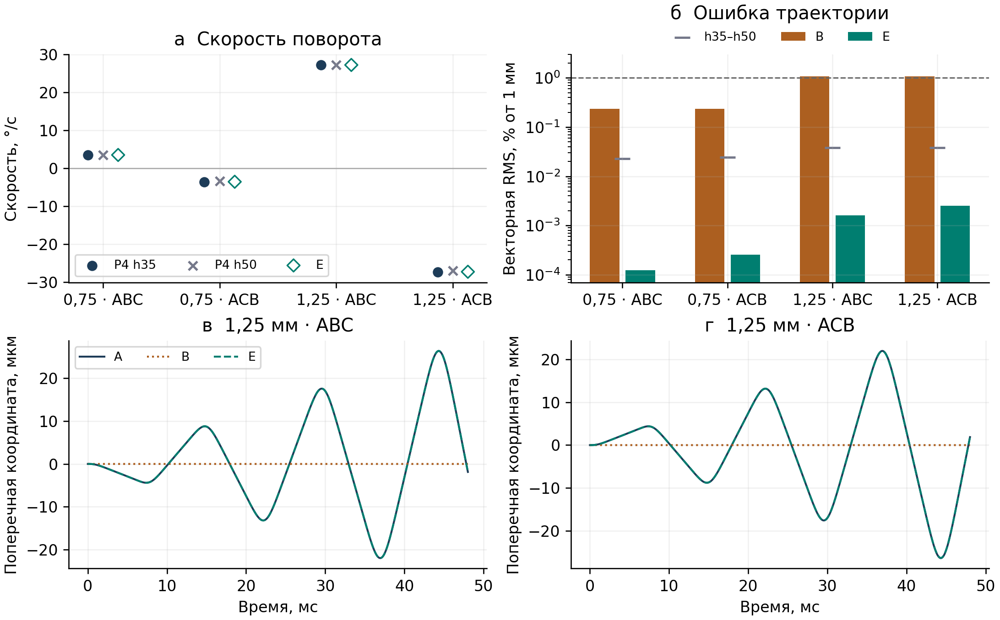

# Проверка скоростной поправки на новых стартах P4

**8 ноября 2026 г.** Модель E воспроизвела знак и скорость поворота линии колебаний на всех четырёх новых стартах. При перестановке фаз ABC → ACB направление поворота сменилось при том же радиусе и азимуте. Коэффициенты E были зафиксированы до расчёта A. [Протокол и воспроизведение](EFFECTIVE_P4_TRANSFER.md) · [Прогнозы](../outputs/effective_reconstruction/p4_transfer/v1/predictions.csv)

## Постановка

Сравнивались прямая RF-динамика A, стандартный FEM-псевдопотенциал B и модель E. В E радиальное удержание задаёт энергия $B_6r^6$, где $B_6=22{,}12392402$ Дж·м⁻⁶. К ускорению добавляется член $\gamma(r)J\dot{\mathbf R}$, где $J(x,y)=(-y,x)$ и

$$
\gamma(r)=\sigma\,(1{,}26760747\,\mathrm{s}^{-1})\left(\frac{r}{1\,\mathrm{mm}}\right)^4,
\qquad \sigma_{\mathrm{ABC}}=+1,\quad \sigma_{\mathrm{ACB}}=-1.
$$

Поправка перпендикулярна скорости и сохраняет энергию модели E. Для обоих направлений на каждом радиусе совпадают медленный старт из покоя и азимут. Полное начальное состояние с микродвижением одинаково на обеих сетках и обоих шагах внутри каждого запуска. Основное сравнение использует центрированное RF-среднее P4 h35 на общем физическом времени. Скорость поворота измерена по наклону угла линии радиальных разворотов. [Вывод модели E](EFFECTIVE_RECONSTRUCTION_V1.tex)

## Траектории и поворот линии колебаний

| Радиус, мм | Фазы | P4 h35, °/с | E, °/с | RMS B, % | RMS E, % | Максимум B / E, % |
|---:|:---:|---:|---:|---:|---:|---:|
| 0,75 | ABC | +3,53248 | +3,53331 | 0,234146 | 0,000125 | 0,56946 / 0,000214 |
| 0,75 | ACB | −3,53694 | −3,53331 | 0,234443 | 0,000258 | 0,57018 / 0,000587 |
| 1,25 | ABC | +27,24813 | +27,26324 | 1,083732 | 0,001623 | 2,63550 / 0,002847 |
| 1,25 | ACB | −27,32063 | −27,26324 | 1,086634 | 0,002538 | 2,64251 / 0,005573 |

Координатные ошибки нормированы на 1 мм. При 1,25 мм B превышает порог 1% RMS при ошибке периода около 0,00023%. Для E на этом радиусе ошибка периода около 0,000124%, а RMS угла составляет 0,00044° для ABC и 0,00165° для ACB относительно h35. В P4 средний период равен примерно 41,051243 мс при 0,75 мм и 14,778417 мс при 1,25 мм. Ошибка среднего радиуса разворота меньше 0,0017 мкм для обеих моделей относительно h35. Ошибка B сосредоточена в поперечной координате. [Полная таблица метрик](../outputs/effective_reconstruction/p4_transfer/v1/analysis/comparisons.csv)

Нечётная по перестановке фаз компонента скорости поворота $[\omega_{\rm ABC}-\omega_{\rm ACB}]/2$ равна +3,53471 и +27,28438°/с. Отношение 7,719 близко к $(1{,}25/0{,}75)^4=7{,}716$. Азимут и начальная RF-фаза меняются вместе с радиусом, поэтому это проверка двух прогнозов E. Для отдельного измерения показателя по радиусу нужна серия с фиксированным азимутом и фазой. Чётная компонента на h35 составляет −0,00223 и −0,03625°/с, обе величины меньше наблюдаемых межсеточных различий. [Данные по направлениям](../outputs/effective_reconstruction/p4_transfer/v1/summary.json)

## Численные контроли

| Контроль | Наблюдаемое изменение |
|---|---:|
| P4 h35 ↔ h50 при `T_RF/100`, векторная RMS | 0,02279–0,03790% |
| P4 h35 ↔ h50 при `T_RF/100`, скорость поворота | 0,03369–0,30996°/с |
| `T_RF/50` ↔ `T_RF/100`, векторная RMS | не более 7,18 × 10⁻⁹% |
| `T_RF/50` ↔ `T_RF/100`, скорость поворота | не более 8,85 × 10⁻⁸°/с |
| Обратная карта ↔ центрированное среднее h35, скорость поворота | не более 6,0 × 10⁻⁸°/с |
| Сырой строб ↔ центрированное среднее h35, скорость поворота | не более 0,0545°/с |

Все четыре старта получили вердикт `supports_E` по заранее заданным критериям. Улучшение по векторной RMS и скорости поворота превышает удвоенный наблюдаемый численный разброс. Малые ошибки E в основной таблице относятся к h35. Межсеточное сравнение задаёт отдельный масштаб чувствительности и не даёт строгой границы ошибки относительно континуума. Сверены SHA итоговых файлов всех 16 запусков, 104 контрольных точек и журналов переходов. [Шаг и сетка](../outputs/effective_reconstruction/p4_transfer/v1/analysis/numerical_controls.csv) · [Фильтры](../outputs/effective_reconstruction/p4_transfer/v1/analysis/slow_diagnostics.csv) · [Вердикты](../outputs/effective_reconstruction/p4_transfer/v1/analysis/verdicts.csv)

## Частотный контроль механизма

В чистом вращающемся октуполе при фиксированных напряжении и радиусе 1 мм коэффициент оценён по разности поперечных ускорений для стартов с противоположными радиальными скоростями. Средние оценки при 80, 100 и 140 кГц равны 2,475314, 1,267605 и 0,461957 с⁻¹. Аппроксимация дала показатель −2,99967 при теоретическом −3. Максимальное относительное отличие отдельной оценки от прогноза составляет 0,0418%. Это независимый аналитический RF-контроль, а частота прямых P4-траекторий равна 100 кГц. [Частотные данные](../outputs/effective_reconstruction/p4_transfer/v1/frequency_sweep/frequency_scaling.csv)

## Формулировка для статьи

Для идеальной 12-электродной ловушки на проверенных стартах радиальный псевдопотенциал воспроизводит период и радиальную амплитуду, а скоростная поправка, выведенная из RF-поля, воспроизводит прецессию и устраняет основную поперечную ошибку. Прямая проверка при новых радиусах 0,75 и 1,25 мм выполнена на 3,25 медленного периода. Прежняя проверка при 1 мм охватывает до 10,25 периода. На горизонте 50 периодов глобальная сходимость прямой динамики по сетке и шагу пока не установлена. [Первый этап реконструкции](../outputs/effective_reconstruction/v1/README.md) · [Ограничения расчёта на 50 периодах](LONG_A_50_RESULTS.md)

[Приложение PDF](../outputs/effective_reconstruction/p4_transfer/v1/report/EFFECTIVE_P4_TRANSFER_RESULTS.pdf) · [Исходник XeLaTeX](EFFECTIVE_P4_TRANSFER_RESULTS.tex)
