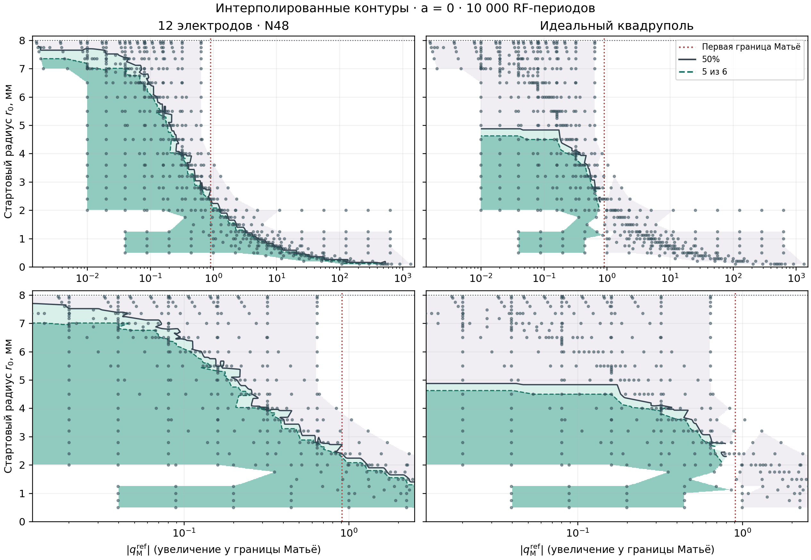
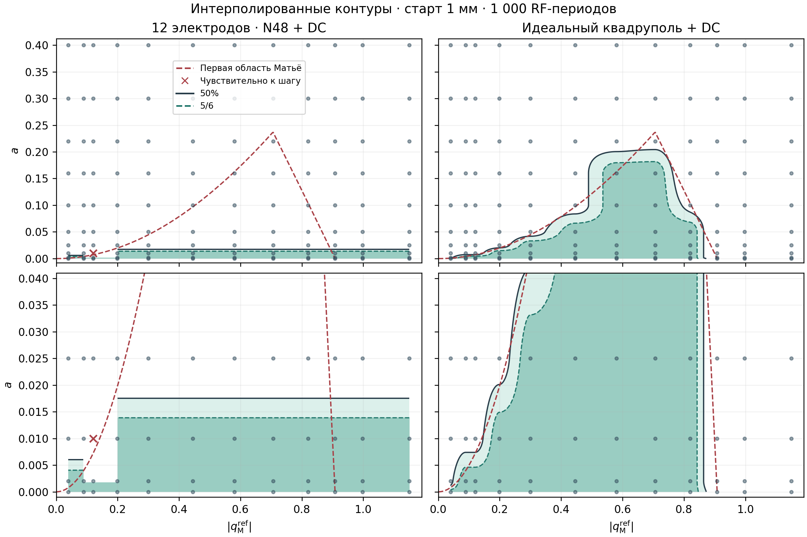

# Результаты для трёхфазной 12-электродной RF-ловушки

[Сводный отчёт PDF с графиками](RESEARCH_RESULTS.pdf) ·
[Исходник XeLaTeX](RESEARCH_RESULTS.tex) ·
[Состав опубликованного набора и SHA-256](../outputs/RESEARCH_RESULTS_SHA256.json)

## Эффективная динамика

Контроль на аналитическом потенциале восстанавливает закон $B_6r^6$
по нескольким амплитудам. Ошибка показателя составила $1{,}2\times10^{-13}$,
относительная ошибка коэффициента $7{,}1\times10^{-10}$. На независимых прямых P4-стартах с радиусов 0,75 и
1,25 мм скоростная модель E воспроизводит скорость и знак прецессии, в том
числе при смене порядка фаз ABC → ACB. При 1,25 мм за 3,25 медленного
периода ошибка координат относительно P4 h35 снизилась с 1,084–1,087%
для стандартного псевдопотенциала B до 0,00162–0,00254% для E.
Наблюдаемый межсеточный разброс составляет 0,023–0,038% и задаёт отдельный
масштаб численной чувствительности. Глобальная сходимость A на 50 медленных
периодах остаётся открытой.

[Реконструкция, коэффициенты и таблицы](../outputs/effective_reconstruction/v1/README.md) ·
[Прямой перенос P4](EFFECTIVE_P4_TRANSFER_RESULTS.md) ·
[Таблица ошибок и численные контроли](../outputs/effective_reconstruction/p4_transfer/v1/analysis/)

## Поперечное удержание

| Серия | Условия | Результат |
|---|---|---|
| $r_0(\lvert q_{\rm M}^{\rm ref}\rvert)$ | $a=0$, 604 точки, 6 стартов на точку, 10 000 RF-периодов | Полное удержание в 248 точках N48 и 91 точке квадруполя. В опорном режиме переход к частичному удержанию лежит на 6,75–6,8125 мм для N48 и 4,5–5,0 мм для квадруполя. |
| $a(\lvert q_{\rm M}^{\rm ref}\rvert)$ | Общий идеальный DC, $r_0=1$ мм, 120 точек, 6 стартов на точку, 1000 RF-периодов | При $\lvert q_{\rm M}^{\rm ref}\rvert=0{,}706$ N48 теряет все старты при $a=0{,}025$, а квадруполь удерживает все даже при $a=0{,}160$. Одна точка N48 чувствительна к шагу и исключена из интерполяции. |
| Локальная устойчивость Флоке | 66 найденных замкнутых решений N48, 3 выборочных контроля на прямых P4 h35 и h50 | Все шесть найденных ветвей линейно неустойчивы. Результат относится к найденным орбитам. |

$|q_{\rm M}^{\rm ref}|$ задаёт общую шкалу RF-напряжения. В N48 эта координата
нормирует нелинейное RF-поле. В идеальном квадруполе это модуль параметра
Матьё. На DC-карте $a=8QU_{\rm DC}/(m\Omega^2 R^2)$ соответствует
одному и тому же идеальному квадрупольному полю в обеих моделях.

[Радиальные карты и данные](STABILITY_P4_EXTENDED_RESULTS.md) ·
[Карты с DC и данные](STABILITY_AQ_RESULTS.md) ·
[Прямые проверки P4](STABILITY_P4_RECHECK.md) ·
[Орбиты и данные Флоке](FLOQUET_PILOT_RESULTS.md)

## Связь с масс-спектрометрией

При фиксированных напряжениях и частоте $a$ и $q_{\rm M}^{\rm ref}$
пропорциональны $|Q|/m$ для частиц одного знака заряда. Карты дают
численную оценку поперечного удержания для конкретного ансамбля вводимых
частиц. Для ионовода практическая проверка состоит в расчёте пропускания
$T(m/z)$ в устройстве конечной длины с одинаковым входным ансамблем и
входными и выходными полями. Для масс-фильтра понадобятся ширина и форма
полосы пропускания. Прямой эталон с обычным двухфазным октуполем позволит
выделить вклад трёхфазного возбуждения.
[Hägg и Szabó, октупольная ионная оптика](https://doi.org/10.1016/0168-1176(86)80003-9)

## Что хранится в Git

В новых каталогах результатов опубликованы итоговые CSV, протоколы,
контрольные суммы, рисунки и отчёты. Таблица
[расширенной серии N48 по каждому старту](../outputs/stability_p4/extended_v2/n48_final_outcomes.csv)
сохраняет статус, время ухода и конечное состояние из итоговых контрольных
точек. Для сравнения по радиусам доступны [парные итоги по клеткам](../outputs/stability_p4/matched_radius_v2/radius_matched_cells.csv),
а для DC-серии — [исходы каждого старта](../outputs/stability_p4/aq_ideal_dc_v1/RF1000/trajectories.csv).

Новые FEM-сетки, массивы полей и траекторий, журналы и рабочие контрольные
точки остаются локально. Некоторые старые отчёты и протоколы ссылаются на
эти входы для полного воспроизведения. Для рисунков и чисел сводного отчёта
достаточно опубликованного набора. Реестр SHA-256 для этого набора ведётся
отдельно от [предыдущей публикации FEM](GITHUB_DATA.md).
