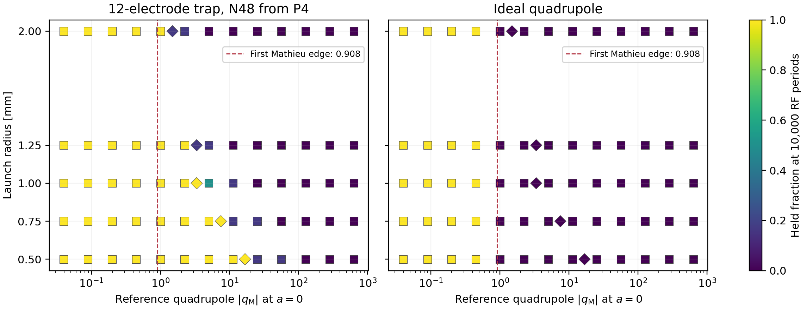

# Сравнение 12-электродной ловушки с идеальным квадруполем

На общей исходной сетке из 390 стартов 12-электродная ловушка удержала 202 частицы по отдельности, идеальный квадруполь — 120. Все 120 стартов, удержанных квадруполем, удержались и в N48. Результат относится к заданному набору стартов и конечному горизонту 10 000 RF-периодов.

## Общая шкала

Для квадруполя задан аналитический потенциал $\Phi_2=U_0(x^2-y^2)\sin(\Omega t+\phi)/R^2$ с $R=8$ мм. Напряжение $U_0$ обозначает пиковую амплитуду относительно земли на вершине идеального электрода. Азимут измеряется относительно оси $x$, ориентированной вдоль электрода A. Начальная RF-фаза отсчитывается от синусоиды напряжения A. Время $\tau=\Omega t/2$ даёт уравнения Матьё с $a_x=a_y=0$ и $q_x=-q_y$.

$$
|q_{\rm M}^{\rm ref}|=\frac{4|q|U_0}{m\Omega^2R^2}=7{,}38880318\,\lambda_4 .
$$

В колонках 12-электродной ловушки это параметр квадруполя при том же режиме, а её собственная локальная мера по ведущему октуполю равна $\eta_0=24\lambda_4(r_0/R)^2$. Расчёт включает все 420 архивных полных стартов, в том числе 30 стартов в пяти уточнённых точках. Критерий ухода в обоих полях — первое пересечение окружности 8 мм наружу.

## Сравнение с диаграммой Матьё

При $a=0$ первая теоретическая граница найдена из $b_1(q)=0$ и равна $|q|=0{,}908046334$. Монодромия за один RF-период согласуется с этой границей. Для квадрупольных стартов с эллиптической монодромией используется верхняя оценка радиуса по огибающей Флоке, включающая микродвижение. Для остальных стартов полный RF-расчёт DOP853 локализует событие ухода. Класс каждого старта и время ухода сверены при ужесточении шага и допусков. [Теоретическая диаграмма NIST DLMF](https://dlmf.nist.gov/28.17)

| Общий параметр Матьё | Стартов | Удержано в N48 | Удержано в квадруполе |
|---:|---:|---:|---:|
| 0,03958, исходный режим | 30 | 30 | 30 |
| 0,44513 | 30 | 30 | 30 |
| 0,99732 | 30 | 30 | 0 |
| 2,23448 | 30 | 25 | 0 |
| 5,00634 | 30 | 16 | 0 |
| Вся исходная сетка | 390 | 202 | 120 |
| Исходная сетка и уточнения | 420 | 222 | 120 |

На рассчитанных точках квадруполь удерживает весь ансамбль при $|q_{\rm M}|\le0{,}44513$. Следующая точка сетки, $0{,}99732$, лежит за первой границей Матьё. Последний из всех уходов квадруполя происходит через 3,920 RF-периода. Утверждение о квадрупольном захвате относится к рассчитанным точкам, а аналитическая граница относится к идеальному линейному уравнению. Промежуток между $0{,}44513$ и $0{,}99732$ на карте захвата остаётся невычисленным.

| Радиус, мм | Прямой P4, удержание при $|q_{\rm M}^{\rm ref}|$ | Прямой P4, уход при $|q_{\rm M}^{\rm ref}|$ |
|---:|---:|---:|
| 0,5 | 16,789 | 25,131 |
| 1,0 | 3,345 | 5,006 |
| 2,0 | 0,997 | 1,493 |

В каждой строке таблицы P4 проверен один конкретный старт на каждом из двух режимов. Класс «уход» при 1 мм воспроизведён при разных шагах и сетках, его время чувствительно к численной настройке. [Исходные P4-проверки](../outputs/stability_p4/p4_recheck_v2/p4_controls_rechecked.csv)

## Оценка площади

На исходных 65 общих точках все шесть стартов удержаны в 32 точках N48 и 20 точках квадруполя. Площадь оценивается по ближайшим ячейкам исходной сетки в одном и том же прямоугольнике $|q_{\rm M}^{\rm ref}|\in[0{,}03958;633{,}26]$, $r_0\in[0{,}5;2]$ мм. Границы ячеек проходят посередине соседних узлов в выбранной координате. Уточнённые точки в эту оценку не входят, поскольку они выбраны по переходам N48.

| Мера площади | Полное удержание N48 | Полное удержание квадруполя |
|---|---:|---:|
| $\mathrm d\log|q_{\rm M}^{\rm ref}|\,\mathrm dr_0$ | 46,53% | 29,17% |
| $\mathrm d|q_{\rm M}^{\rm ref}|\,\mathrm dr_0$ | 0,796% | 0,108% |

На логарифмической шкале отношение площадей полного удержания около 1,60. Средняя доля удержанных стартов с теми же весами составляет 48,96% и 29,17%. При линейной шкале большая часть выбранного диапазона приходится на сильное RF-воздействие, где обе карты показывают уход. Поэтому численное отношение площадей зависит от меры и границ области. Это оценка площади карты запуска на конечном времени для поперечной одночастичной задачи.



[Парные траектории и исходы](../outputs/stability_p4/mathieu_comparison_v1/matched_trajectories.csv) · [Сетка сравнения](../outputs/stability_p4/mathieu_comparison_v1/matched_cells.csv) · [Параметры Матьё и монодромия](../outputs/stability_p4/mathieu_comparison_v1/mathieu_axis.csv) · [Сводка и SHA входов](../outputs/stability_p4/mathieu_comparison_v1/summary.json)

Повтор из корня репозитория в новую папку:

```powershell
& 'C:/Python314/python.exe' -B scripts/compare_mathieu_stability.py --out outputs/stability_p4/mathieu_comparison_replay
```
