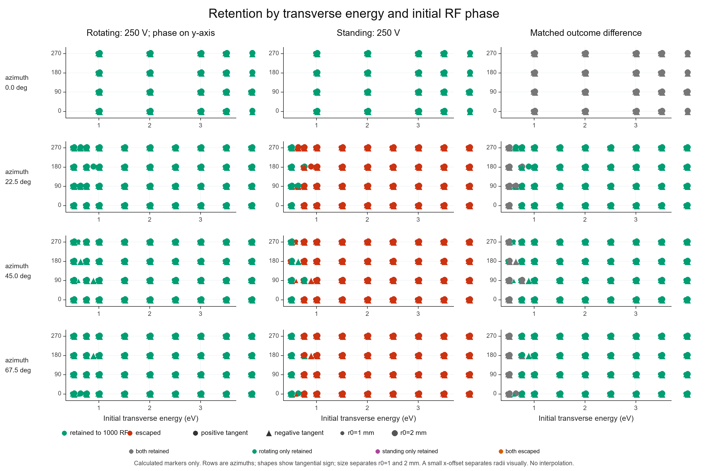
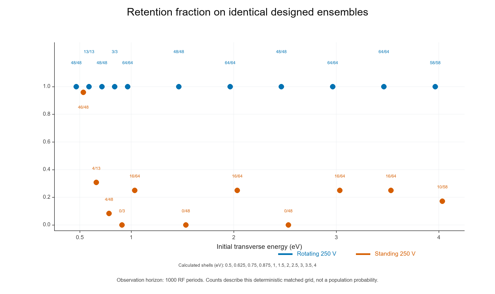
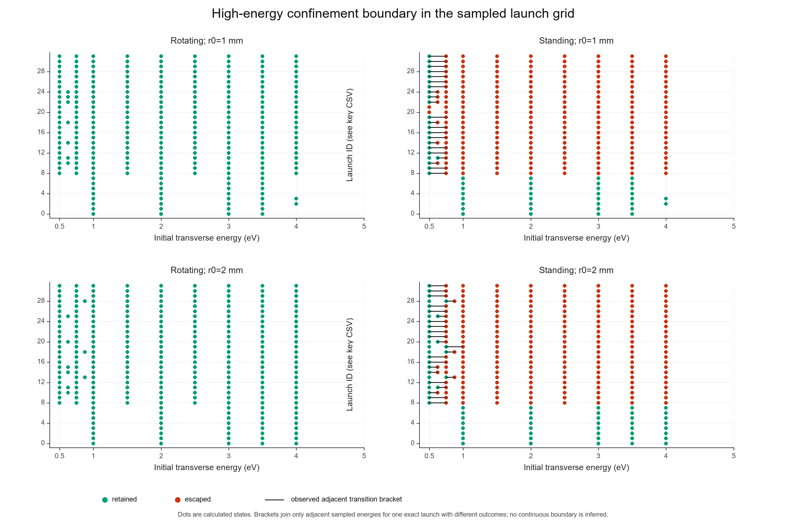
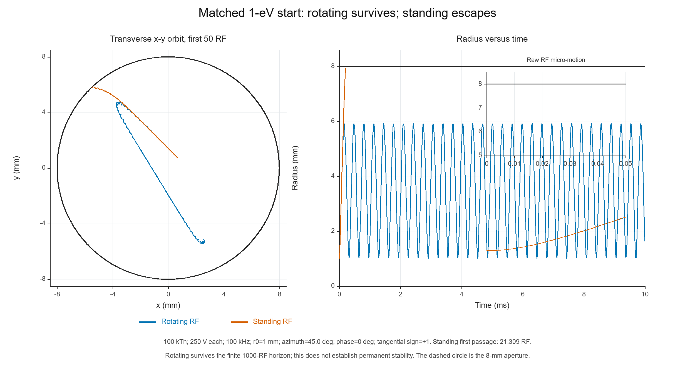
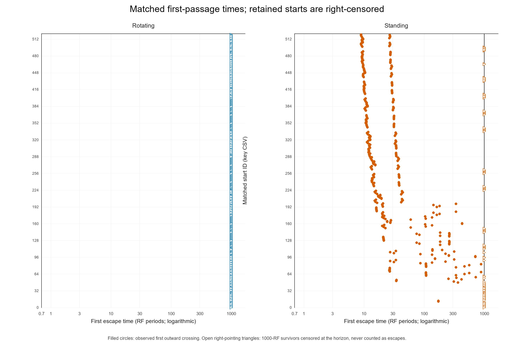
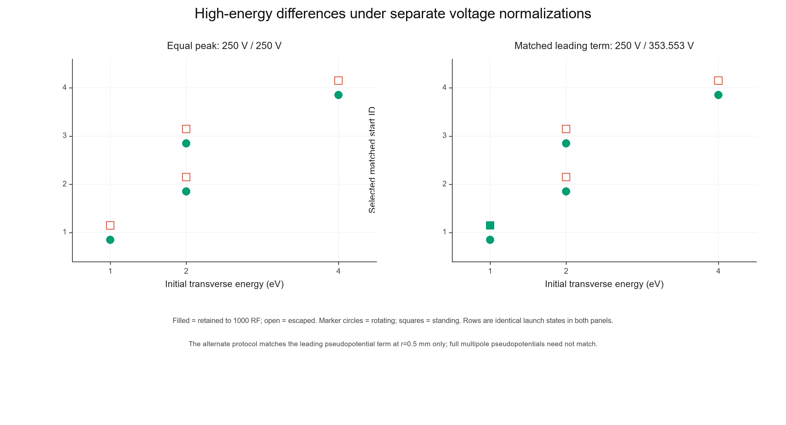

# Высокоэнергетическая граница удержания вращающимся и стоячим октуполями — V4

## Краткий вывод

**На сетке равного пикового напряжения rotating удержал 522/522 стартов, standing — 128/522; единственная асимметрия исходов — 394 начальных условия в пользу rotating.** В плотной сетке рассчитаны **522 matched старта** при равных пиковых напряжениях 250/250 В; в 394 случаях rotating удерживает частицу до 1000 RF, а standing выходит за апертуру. Обратных точек, где только standing удерживает, на данной выборке нет. Этот результат относится только к конечному горизонту 10 мс и перечисленным точкам начальных условий; он не является вероятностью для реального ансамбля и не доказывает бессрочную устойчивость.

В отдельном протоколе с matched leading pseudopotential использованы rotating 250 В и standing 353.553 В. Для него рассчитано 4 пары: matched-strength пары дали следующие классы: обе удерживают — 1; только rotating удерживает — 3; только standing удерживает — 0; обе выходят — 0. Эти строки не смешиваются с equal-peak сеткой. Две нормировки в выводах и таблицах не объединяются.

## Сравнение с V3

V3 установил конечновременное удержание при исправленной шкале полного RF, но его высокоэнергетическая сетка содержала 24 matched запуска и четыре сочетания азимута, RF-фазы и знака касательной скорости на энергетической оболочке. V4 повторно использует их успешно завершённые интеграции и расширяет выборку до четырёх RF-фаз, четырёх азимутов и обоих знаков тангенциальной скорости для каждого радиуса 1 и 2 мм и энергий 1, 2 и 3 эВ. Это **336 новых интеграций основной сетки** плюс локальные адаптивные точки.

Классификации полных RF-траекторий из V1/V2 с меткой 250 В не использовались: там интегратор не умножал единичные FEM-поля на заявленное напряжение. V4 использует проверенный код V3 и N48-реконструкции h35/h50 из опубликованных FEM-решений; новые FEM-расчёты не выполнялись.

## Модель и план расчёта

- Ион: одиночно заряженный, `m/z = 100 kTh`, масса `1.66053906660×10⁻²² kg`; частота RF — 100 кГц.
- Геометрия: круглая поперечная апертура 8 мм; начальные радиусы 1 и 2 мм. Сравниваются вращающееся поле и стоячая волна на одной геометрии и с одинаковыми физическими стартами.
- Основной протокол: 250 В / 250 В. Начальная поперечная энергия 1, 2 и 3 эВ; RF-фазы 0°, 90°, 180°, 270°; азимуты 0°, 22.5°, 45°, 67.5°; положительная и отрицательная тангенциальные скорости.
- Основной горизонт — 1000 RF-периодов (10 мс). Выход — первое наружное пересечение радиуса 8 мм. Выжившие на всём горизонте обозначены `retained, 1000 RF`; время выхода для них не назначается, а наблюдение считается правосторонне цензурированным.
- DOP853: стандарт `rtol=2×10⁻⁹`, `max_step=T_RF/50`; выборочные строгие проверки `rtol=2×10⁻¹¹`, `max_step=T_RF/100`. Сохранены начальное состояние, RF-фаза, модель, напряжение, частота, исход, время первого выхода, максимальный и RMS-радиус на сетке сохранения, радиальная огибающая, период и число радиальных максимумов, а также статус численной проверки. Новые основные V4-трассы стробоскопические (1 отсчёт/RF); для репрезентативных граничных пар отдельно рассчитана чувствительность радиальных метрик при 8 отсчётах/RF. V3-трассы использованы в исходной детализации 8 отсчётов/RF; поле `samples_per_RF_observed` позволяет различить эти ряды.

Сетка расширялась адаптивно вокруг обнаруженных различий исходов, соседних энергетических точек с разными исходами одной модели, изменений различия радиальной динамики между matched-моделями и состояний с близкой к апертуре огибающей. Ограниченные внешние пробы назначались условно: 0.5 эВ — при расхождении моделей на 1 эВ; 3.5 эВ — при расхождении или близкой апертуре на 3 эВ; 4 эВ — только при расхождении на 3.5 эВ или экскурсии радиуса не менее 7.5 мм. Третий шаг локализации исполнил только 32 задания вокруг 16 фактически обнаруженных status-скобок на 0.625 и 0.875 эВ; прочие динамические кандидаты этого шага не запускались. Каждая чёрная скобка на рисунке C отмечает лишь соседние рассчитанные энергии одной и той же траектории-старта с разными статусами. Она не задаёт гладкую или универсальную границу.

Для повторного теста поля h50 использованы те же сохранённые FEM-реконструкции другого уровня сетки; геометрическая сетка FEM не перестраивалась. Строгие DOP853-повторы и h50-повторы охватывают 4 выбранных граничных стартов. Подробные попарные проверки приведены в `numerical_checks.csv`.

## Результаты при равных пиковых напряжениях

На всех рассчитанных matched стартах наблюдались четыре возможных класса: обе модели удерживают; удерживает только rotating; удерживает только standing; обе модели выходят. Их количества составили: **обе удерживают** — 128; **только rotating удерживает** — 394; **только standing удерживает** — 0; **обе выходят** — 0.

Ниже приведены доли удержанных точек **внутри конкретно рассчитанной детерминированной сетки**, а не оценки вероятности для распределения ионов:

- **0.5 эВ:** rotating 48/48, standing 46/48 (48 matched-старта).
- **0.625 эВ:** rotating 13/13, standing 4/13 (13 matched-старта).
- **0.75 эВ:** rotating 48/48, standing 4/48 (48 matched-старта).
- **0.875 эВ:** rotating 3/3, standing 0/3 (3 matched-старта).
- **1 эВ:** rotating 64/64, standing 16/64 (64 matched-старта).
- **1.5 эВ:** rotating 48/48, standing 0/48 (48 matched-старта).
- **2 эВ:** rotating 64/64, standing 16/64 (64 matched-старта).
- **2.5 эВ:** rotating 48/48, standing 0/48 (48 matched-старта).
- **3 эВ:** rotating 64/64, standing 16/64 (64 matched-старта).
- **3.5 эВ:** rotating 64/64, standing 16/64 (64 matched-старта).
- **4 эВ:** rotating 58/58, standing 10/58 (58 matched-старта).

Среди случаев, где rotating и standing различались, первый наружный выход стоячей модели лежал в диапазоне 8.931–882.757 RF. Удержанные траектории учитывались как цензурированные на 1000 RF, а не как выходы в конце окна.

### Рисунки

**A. Энергия и начальная RF-фаза.** Ряды разделены по азимуту; маркер показывает знак тангенциальной скорости, размер — начальный радиус. Третья колонка напрямую кодирует парный исход двух моделей. Все маркеры соответствуют реально рассчитанным стартовым состояниям.



**B. Доля удержанных точек для каждого рассчитанного энергетического слоя.** Надписи указывают `retained / n` matched-пар; кривые и сглаживание не используются.



**C. Энергетические переходы на дискретных начальных условиях.** Короткий отрезок показывает только рассчитанный интервал между соседними энергетическими точками с различными исходами на неизменной фазе, азимуте и направлении скорости.



**D. Один парный пример rotating-retained / standing-escaped.** Слева показана x-y-геометрия первых 50 RF-периодов; круг — апертура 8 мм. Основная временная кривая показывает радиус, усреднённый за RF-период, а вставка — RF-микродвижение первых пяти периодов. Стоячая модель показана до первого выхода. Выжившая вращающаяся траектория не объявляется навсегда устойчивой.



**E. Время первого выхода.** Закрашенные круги — наблюдённые первые пересечения; пустые треугольники направо — правостороннее цензурирование выживших на 1000 RF.



**F. Равный пик и matched leading pseudopotential.** Повторно показаны те же выбранные граничные старты. Во второй панели standing получает 353.553 В. Это отдельная нормировка: равенство ведущего члена не делает полные мультипольные псевдопотенциалы идентичными.



## Нормировка псевдопотенциала

При одинаковом пиковом напряжении вращающееся поле задействует две RF-квадратуры, а стоячее — одну. Поэтому равные 250 В не являются сравнением с равной ведущей силой псевдопотенциала. Отдельный протокол использует `250√2 = 353.553 V` для стоячего октуполя при сохранении rotating 250 В и частоты 100 кГц. Он проверяет, сохраняется ли различие на выбранных энергетических границах после подгонки ведущего члена на опорном радиусе 0.5 мм.

matched-strength пары дали следующие классы: обе удерживают — 1; только rotating удерживает — 3; только standing удерживает — 0; обе выходят — 0. Эти строки не смешиваются с equal-peak сеткой. Медианная разность максимального радиуса (matched minus equal peak, по выбранным matched стартам) — +0.000 мм.

## Численная устойчивость и исполнение

- Строгий DOP853-повтор согласился по классификации в 8 из 8 граничных контрольных интеграций; максимальное расхождение времени выхода составило 8.3e-12 RF, максимальное различие радиуса — 1.96e-08 мкм.
- Увеличение частоты сохранённых точек с 1 до 8/RF для 8 граничных траекторий сохранило 8 классификаций; максимальное изменение наблюдённого максимального радиуса составило 25.9 мкм, RMS-радиуса — 252 мкм.
- h35/h50 дал одинаковую классификацию в 8 из 8 попарных проверок; максимальное различие максимального радиуса — 0.272 мкм.
- Новые интеграции выполнялись четырьмя CPU workers, по одному потоку BLAS на worker. Старт — 2026-11-11T10:37:39Z, последний завершённый интеграционный этап — 2026-11-11 12:13:01 UTC, wall-clock — 95.4 min. Жёсткий дедлайн был 2026-11-11 12:37:39 UTC; новые задания после него не запускались.
- Выполнено 1024 новых успешных RF-траекторий; численные отказы — 0. Журнал с контрольными точками каждого задания находится в `trajectory_checkpoint.jsonl`, атомарные контрольные файлы — в `checkpoints/`. Набор V3 включён как переиспользованные строки и компактные необходимые траектории.

Изображения сохранены как PDF, SVG и PNG (300 dpi) одним согласованным стилем. Matplotlib в доступном Python отсутствовал, поэтому использован уже существующий локальный рендерер на Pillow и ReportLab: PNG растровые, PDF/SVG векторные.

## Интерпретация и границы вывода

На вопрос о преимуществе rotating ответ для данной сетки: **Вращающееся поле демонстрирует конечновременное преимущество на проверенной сетке при равных 250 В: в 394 matched-стартах удержание было только для rotating. Это локальный вывод о данной сетке, а не универсальное преимущество для произвольной фазы, энергии или прибора.** Числа описывают специально выбранные начальные условия, а не равномерную популяцию ионов. Адаптивные энергетические скобки показывают переходы только в просканированных интервалах; одинаковый исход на концах интервала не исключает неразрешённую узкую островную область между ними.

Расчёт — двумерная поперечная модель. Он не устанавливает бесконечную устойчивость, трёхмерную передачу через конечную длину фильтра, axial/fringe-field потери, столкновения, пространственный заряд, mass resolving power или распределение выхода в реальном приборе.

## Данные и повторение

Важные файлы: `study_config_v4.json`, `run_v4.py`, `analyze_v4.py`, `render_figures_v4.py`, `trajectory_results_v4.csv`, `equal_peak_main_grid.csv`, `matched_pairs_equal_peak.csv`, `matched_pairs_all_protocols.csv`, `numerical_checks.csv`, `normalization_comparison.csv`, `analysis_summary_v4.json`, `numerical_validation_summary.json`, `matched_strength_summary.json` и `integration_deadline.json`.

Команды PowerShell из корня репозитория:

```powershell
$env:OPENBLAS_NUM_THREADS = "1"
$env:MKL_NUM_THREADS = "1"
$env:OMP_NUM_THREADS = "1"
python outputs/octupole_comparison_home/confinement_maps_v4/run_v4.py grid --workers 4
python outputs/octupole_comparison_home/confinement_maps_v4/analyze_v4.py refine --round 1
python outputs/octupole_comparison_home/confinement_maps_v4/run_v4.py custom --jobs-json outputs/octupole_comparison_home/confinement_maps_v4/adaptive_round1_jobs.json --workers 4
python outputs/octupole_comparison_home/confinement_maps_v4/analyze_v4.py refine --round 2
python outputs/octupole_comparison_home/confinement_maps_v4/run_v4.py custom --jobs-json outputs/octupole_comparison_home/confinement_maps_v4/adaptive_round2_jobs.json --workers 4
python outputs/octupole_comparison_home/confinement_maps_v4/analyze_v4.py followup
python outputs/octupole_comparison_home/confinement_maps_v4/run_v4.py custom --jobs-json outputs/octupole_comparison_home/confinement_maps_v4/numerical_field_strength_validation_jobs.json --workers 4
python outputs/octupole_comparison_home/confinement_maps_v4/analyze_v4.py collect
python outputs/octupole_comparison_home/confinement_maps_v4/render_figures_v4.py
```

В рабочем журнале сохраняются V3-строки для основной сетки, так что успешные V3-интеграции не нужно повторять. Команда `run_v4.py` использует атомарные checkpoints и существующий N48-кэш; новые интеграции с истёкшим дедлайном запрещаются.
